<p align="center">
  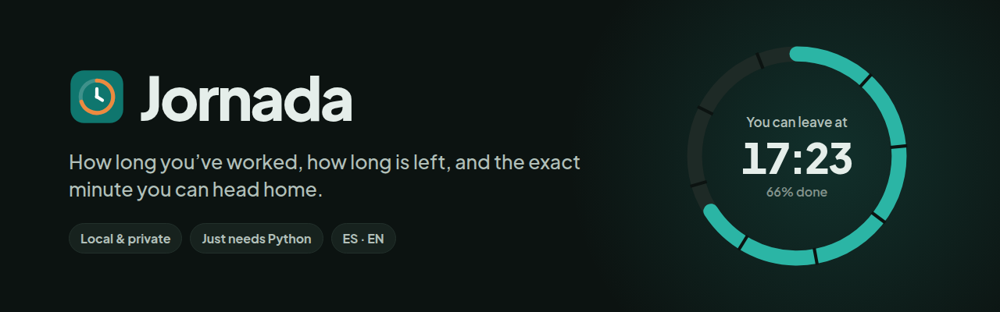
</p>

<p align="center">
  <a href="LICENSE"></a>
  
  
  
  
  
</p>

<p align="center">
  <a href="README.md">Español</a> · <b>English</b>
</p>

<p align="center">
  <a href="#quick-install-on-linux">Install</a> ·
  <a href="#using-jornada">Usage</a> ·
  <a href="#keyboard-shortcuts">Shortcuts</a> ·
  <a href="#export-and-import">Export &amp; import</a> ·
  <a href="#storage-and-privacy">Privacy</a> ·
  <a href="#troubleshooting">Troubleshooting</a>
</p>

---

**Jornada** is a small web app that runs on your own computer. At a glance, it tells you how long you've worked,
how long is left and **the exact minute you can leave**, breaks included. It works offline, keeps everything in a local
JSON file and doesn't need administrator rights.

> [!IMPORTANT]
> Jornada is a **personal tool**. It is not an official time-keeping system and has no legal or employment value.
> It's for your own tracking.

## Contents

1. [Screenshots and demo](#screenshots-and-demo)
2. [Main features](#main-features)
3. [Requirements](#requirements)
4. [Quick install on Linux](#quick-install-on-linux)
5. [Quick install on Windows](#quick-install-on-windows)
6. [Create a desktop shortcut](#create-a-desktop-shortcut)
7. [Using Jornada](#using-jornada)
8. [Standard and short-day schedules](#standard-and-short-day-schedules)
9. [Keyboard shortcuts](#keyboard-shortcuts)
10. [Export and import](#export-and-import)
11. [Languages and themes](#languages-and-themes)
12. [Storage and privacy](#storage-and-privacy)
13. [Project structure](#project-structure)
14. [Development and tests](#development-and-tests)
15. [Troubleshooting](#troubleshooting)
16. [Roadmap](#roadmap)
17. [Contributing](#contributing)
18. [License](#license)

## Screenshots and demo

<p align="center">
  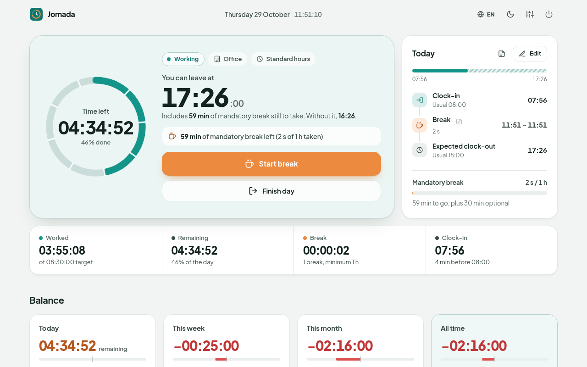
</p>

<p align="center">
  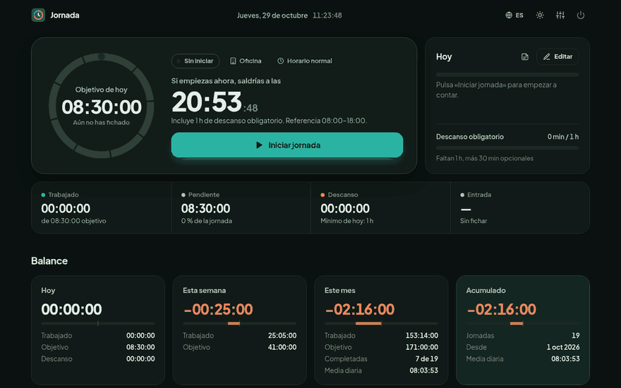<br>
  <sub>Start day → break → back to work → day complete (real recording, fictitious data, Spanish interface).</sub>
</p>

<table>
  <tr>
    <td width="50%">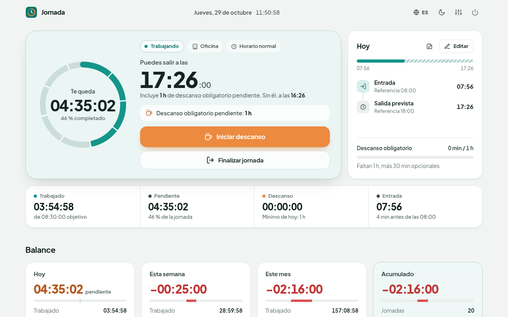<br><sub><b>Light mode</b>: working, with the expected leaving time.</sub></td>
    <td width="50%">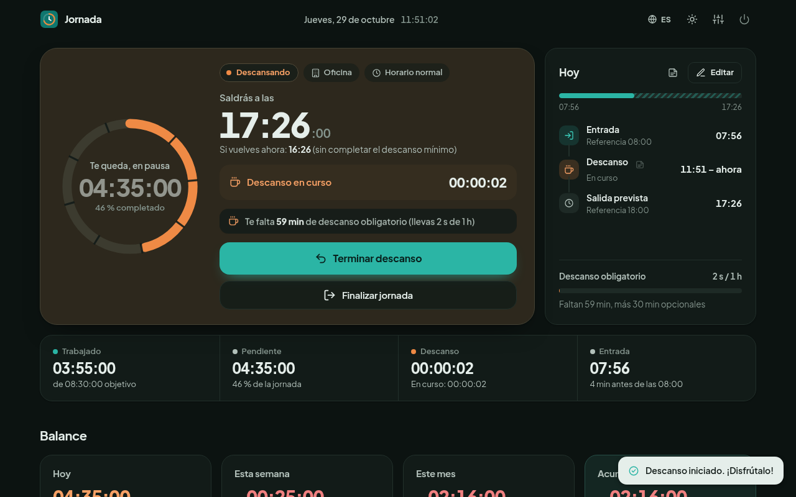<br><sub><b>Dark mode</b>: on a break, the panel turns warm.</sub></td>
  </tr>
  <tr>
    <td>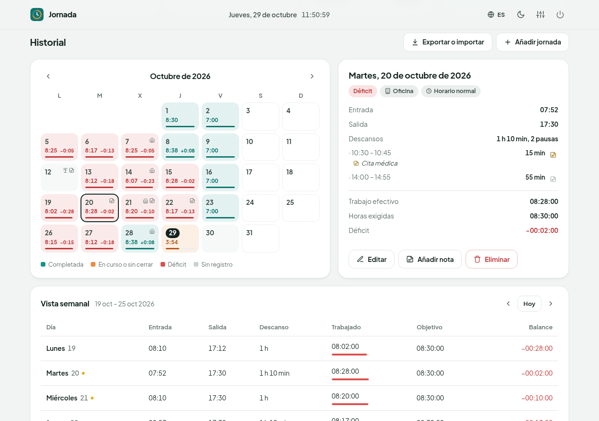<br><sub><b>History</b>: calendar, day details with notes and week view.</sub></td>
    <td>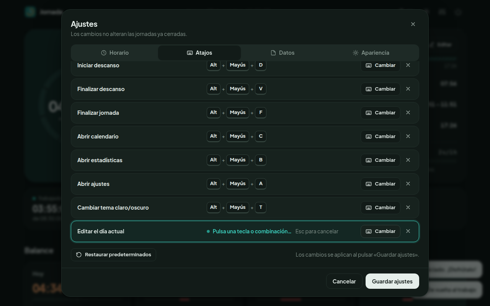<br><sub><b>Shortcuts</b>: assign any combination, game-controls style.</sub></td>
  </tr>
  <tr>
    <td>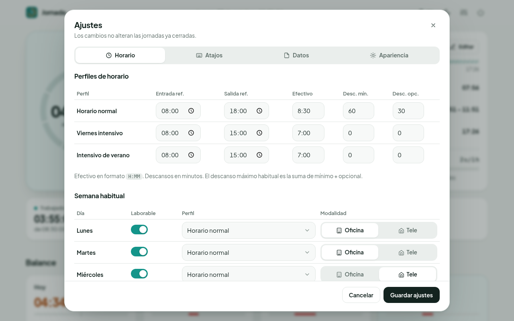<br><sub><b>Settings</b>: schedules, usual week and summer hours.</sub></td>
    <td>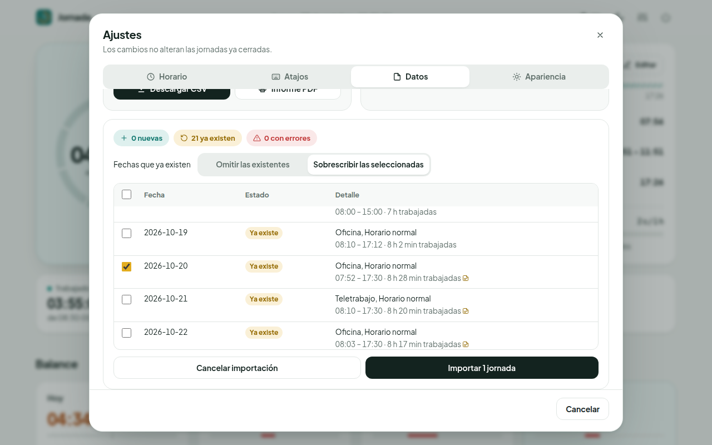<br><sub><b>Import</b>: a preview before anything is saved.</sub></td>
  </tr>
  <tr>
    <td>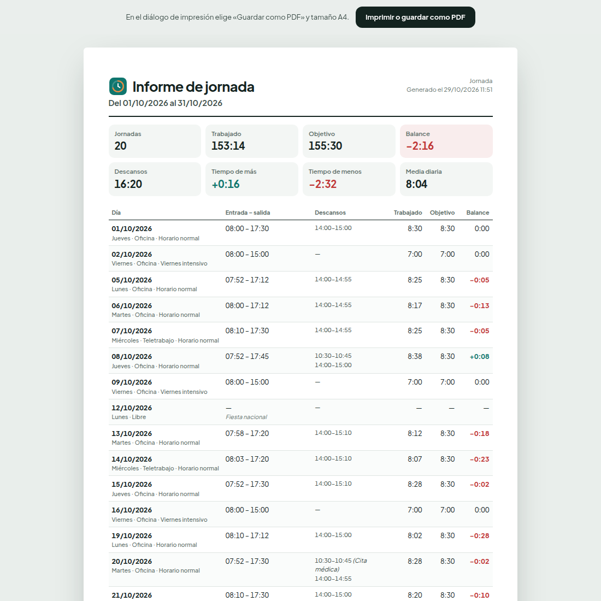<br><sub><b>PDF report</b>: ready to print on A4.</sub></td>
    <td align="center">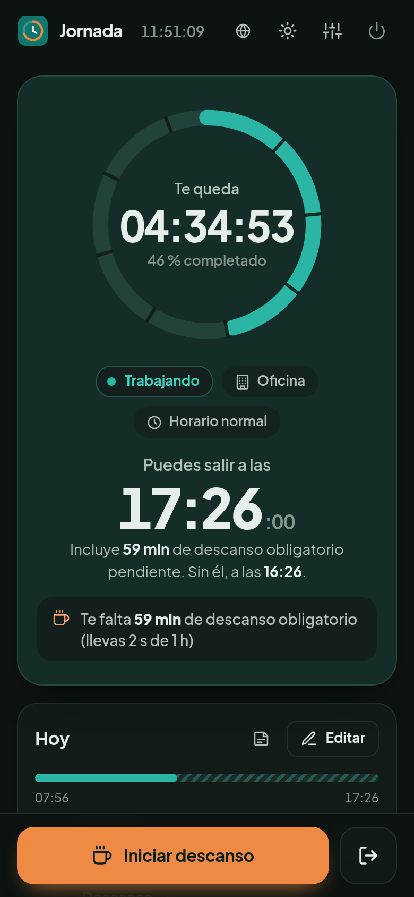<br><sub><b>Mobile</b>: the main action sits within thumb reach.</sub></td>
  </tr>
</table>

<sub>All screenshots show the real app with fictitious data. Apart from the first one, they show the Spanish interface.</sub>

## Main features

| | |
|---|---|
| ⏱️ **Live countdown** | Time left updates every second. It's calculated from saved timestamps, so it stays exact even if you close the browser or the computer sleeps. |
| 🏁 **Exact leaving time** | Includes any mandatory break still to take. It also shows when you'd leave without it, and with your optional break. |
| ☕ **Multiple breaks** | During a break, work time freezes and a second timer runs. You're warned if the minimum break is missing. |
| 🎉 **Day complete** | A subtle celebration when you hit your target; keep working and overtime starts counting. |
| ⚖️ **Flexible balance** | Time over and under per day, week, month and all time. It warns but never blocks. |
| 🗓️ **Schedules** | Standard hours, short Friday and summer hours by date, plus a manual schedule for any single day. |
| 📝 **Notes** | One note per day and one per break. They never change any calculation. |
| ⌨️ **Custom shortcuts** | Any key combination for the main actions, with conflict detection. |
| 📤 **CSV and PDF** | Export full history, a week, a month or a date range. Printable A4 report. |
| 📥 **Safe import** | Preview, duplicate handling and a backup before saving. |
| 🌍 **Spanish and English** | Switches instantly, no page reload. |
| 🌗 **Light and dark** | Light, dark or system theme; layouts adapted to desktop, tablet and phone. |
| ♿ **Accessible** | Full keyboard navigation with visible focus, touch-friendly buttons and support for `prefers-reduced-motion`. |

## Requirements

- **Python 3.10 or newer.** It's the only thing you need. Flask and its dependencies are already bundled in
  the [`vendor/`](vendor/) folder.
- A modern browser: Firefox, Chrome, Edge or Safari.

You do **not** need `pip`, `npm`, Node.js, Docker, a database, an internet connection or administrator rights.

> [!NOTE]
> Jornada is not a standalone executable: it can't run without Python. If your computer doesn't have it,
> see [how to get it without admin rights](#python-isnt-found).

## Quick install on Linux

**Option A: with Git**

```bash
git clone https://github.com/<your-username>/jornada.git
cd jornada
./iniciar.sh
```

**Option B: downloading the ZIP**

1. On GitHub, click **Code → Download ZIP**.
2. Unzip it inside your home folder, for example `~/jornada`.
3. Open a terminal in that folder and run `./iniciar.sh`.

Your browser opens `http://127.0.0.1:8765`. For a desktop icon, see
[Create a desktop shortcut](#create-a-desktop-shortcut).

## Quick install on Windows

1. Download the project, with `git clone` or as a ZIP, and unzip it in your user folder.
2. Double-click **`iniciar.bat`**.
3. A console opens (that's the server), along with Jornada in your browser.

If the launcher can't find Python, it explains alternatives that **don't need admin rights**.
See also [Python isn't found](#python-isnt-found).

## Create a desktop shortcut

On **Linux**, once and without `sudo`:

```bash
./instalar-escritorio.sh
```

This creates:

- `~/.local/share/applications/jornada.desktop`: Jornada shows up in your applications menu.
- `~/Desktop/Jornada.desktop` (or your localized desktop folder): the desktop icon.
- `Jornada.desktop` inside the project, to start it from your file manager.

If your desktop marks the icon as "untrusted", allow it once:

| Desktop | What to do |
|---|---|
| GNOME / Ubuntu | Right-click the icon → **Allow Launching**. |
| KDE Plasma | On first double-click, choose **Execute** and "Do not ask again". |
| XFCE | **Mark executable** or **Launch anyway**. |
| Cinnamon / MATE | Properties → Permissions → **Allow executing file as program**. |

If you move the project folder, run the script again. To remove the shortcuts, run
`./instalar-escritorio.sh --quitar`; your data isn't touched.

On **Windows**, create a shortcut to `iniciar.bat` (right-click → *Send to → Desktop*).

## Using Jornada

### Open and quit

- **Open:** double-click the icon, `iniciar.sh` or `iniciar.bat`. If Jornada is already running, only the
  browser opens; a second instance is never created.
- **Quit completely:** the **⏻** button, top right → *Quit Jornada*. It stops the server and frees the port.
  Closing just the tab does not stop the server.
- **Auto-quit:** if nobody uses it for 12 hours, it closes itself. Change that with `JORNADA_IDLE_HOURS`;
  with `0` it never closes.

### An example day

With standard hours: 8 h 30 min of work and a 1 h mandatory break.

| Time | What you do | What Jornada shows |
|---|---|---|
| **07:53** | Press **Start day** | Expected clock-out **17:23** (07:53 + 8 h 30 min + 1 h break). |
| **12:00** | Check the dashboard | Worked **4 h 07 min**; **4 h 23 min** left; leaving at **17:23**. |
| **14:50** | **Start break** | Work time freezes; a second timer measures the break. |
| **15:49** | **End break** (59 min) | Before the break: 6 h 57 min. **1 h 33 min** left: you can leave at **17:22**. **1 min** of mandatory break is still missing; take it and you leave at **17:23**. |
| **17:22** | — | **Day complete! You can head home.** From here on it counts as overtime. |
| **17:45** | **Finish day** | Worked **8 h 53 min**: day balance **+23 min**. |

The balance accumulates without forcing you to make it up. With +25, −15, +40 and −10 minutes over four days,
the week's balance is **+40 min**. You can check it in the **Balance** section (today, week, month and all time)
and in the calendar, where each day shows its hours and its overtime or shortfall.

### Fixing entries

- **Edit** opens the day editor: clock-in, clock-out, breaks, schedule, target and notes.
  Clock-out and breaks are validated: no clock-out before clock-in, no overlapping breaks and no future times.
- **Add day** records a day you forgot to clock.
- **Resume day** undoes an accidental "Finish": the gap counts as a break.

### Notes

- **Day note:** the 📝 icon in the "Today" card, or "Add note" in any day's details.
- **Break note:** the 📝 icon next to each break, in the timeline or in the day's details.
- There are quick suggestions, such as "Team meeting" or "Doctor's appointment". Notes show subtly in the calendar and are included in exports.
  **They never change any time calculation.**

## Standard and short-day schedules

| Schedule | Default (editable in *Settings → Schedule*) |
|---|---|
| Standard hours | 08:00–18:00 · 8 h 30 min · 60 min break + 30 optional |
| Short Friday | 08:00–15:00 · 7 h |
| Summer hours | 08:00–15:00 · 7 h · applied by date, for example 1 July to 31 August |

- Each weekday has its own schedule, working-day flag and work mode (office or remote).
- **Priority:** a schedule picked by hand for a day > summer period > usual week.
- Every day **keeps the schedule and target it had**, so changing settings never rewrites the past.
- 7 h worked on a 7 h day gives a balance of 0, never a shortfall.

## Keyboard shortcuts

*Settings → Shortcuts.* Click **Assign key**, then press the combination you want.

| Action | Default |
|---|---|
| Start day | <kbd>Alt</kbd> + <kbd>Shift</kbd> + <kbd>I</kbd> |
| Start break | <kbd>Alt</kbd> + <kbd>Shift</kbd> + <kbd>D</kbd> |
| End break | <kbd>Alt</kbd> + <kbd>Shift</kbd> + <kbd>V</kbd> |
| Finish day | <kbd>Alt</kbd> + <kbd>Shift</kbd> + <kbd>F</kbd> |
| Open calendar | <kbd>Alt</kbd> + <kbd>Shift</kbd> + <kbd>C</kbd> |
| Open statistics | <kbd>Alt</kbd> + <kbd>Shift</kbd> + <kbd>B</kbd> |
| Open settings | <kbd>Alt</kbd> + <kbd>Shift</kbd> + <kbd>A</kbd> |
| Toggle light/dark theme | <kbd>Alt</kbd> + <kbd>Shift</kbd> + <kbd>T</kbd> |
| Edit today | <kbd>Alt</kbd> + <kbd>Shift</kbd> + <kbd>E</kbd> |

The defaults follow the Spanish action names (I = *Iniciar*, D = *Descanso*…); reassign them to whatever suits you.

- **Duplicates:** Jornada detects them and won't assign them.
- **Reserved shortcuts:** it warns about combinations usually owned by the browser or OS (for example <kbd>Ctrl</kbd>+<kbd>T</kbd>).
- **Managing them:** you can remove a binding or restore the defaults.
- **When they work:** only while the Jornada tab is focused, never while you're typing in a field or with a window open.
- **What they do:** only actions valid at that moment; for example, "End break" does nothing unless you're on a break.
- **Physical keys:** keys are identified by position (`KeyboardEvent.code`), so they work the same on any keyboard layout.
- **No global shortcuts:** nothing is installed at system level.

## Export and import

From **History → Export or import**, or *Settings → Data*.

### Export

- **What:** full history, this week, the selected month or a date range.
- **CSV:** works with Excel and LibreOffice (UTF-8, semicolon-separated). One column per field: date, work mode,
  schedule, clock-in, clock-out, time worked, target, balance, notes and every break with its note.
- **PDF report:** opens a page ready to print or *Save as PDF* on A4, with a table of days and a period
  summary (worked, target, breaks, time over and under).

### Import

1. Pick or drop a CSV. It can be one exported by Jornada, even after re-saving it in Excel.
2. Jornada validates the **whole** file (dates, times, breaks and structure) and shows a preview: new, already existing and with errors.
3. For dates that already exist, choose to **skip them** or **overwrite only the ones you tick**. Overwriting asks for confirmation.
4. On confirmation, **a backup** is saved in `data/backups/` and the changes are written in a single step.

If anything changes between the preview and the confirmation, the import stops without writing anything.
Exporting and re-importing keeps all relevant data; automated tests check this.

## Languages and themes

- **Language:** Spanish (default) or English, from the 🌐 button in the top bar or in *Settings → Appearance*.
  It switches instantly, without reloading, and is saved.
- **Theme:** light, dark or system (the ☀️/🌙 button or *Settings → Appearance*).
- **Formats:** 24 h or 12 h clock, and durations as `02:34:18` or `2 h 34 min`.

Strings live in [`static/i18n/`](static/i18n/). To add a language, copy `es.json` under a new name,
translate it and add its code to `LANGUAGES` in [`i18n.py`](i18n.py).

## Storage and privacy

- 🏠 **Everything stays on your computer**, in the `data/` folder. No accounts, no external database, no cloud sync.
- 🔒 **Localhost only:** the server listens on `127.0.0.1` and rejects requests that use any other host name.
- 📴 **Offline:** no CDN is used; the font and icons are bundled.
- 💾 **Safe saving:** every change is written instantly and atomically (temporary file, `fsync` and `os.replace`).
  The previous version is kept as `*.json.bak`.

| File | Contents |
|---|---|
| `data/records.json` | Your days: entries, breaks, notes, schedule and target for each day |
| `data/settings.json` | Schedules, week, summer hours, shortcuts, language and appearance |
| `data/backups/` | Backups made before each import |

> [!WARNING]
> **Never commit `data/` to any repository.** The project's `.gitignore` already excludes it, along with the generated
> shortcut, which contains paths from your computer.

## Project structure

```text
jornada/
├── app.py                 Flask server (127.0.0.1 only), API, lifecycle and port handling
├── core.py                Calculations, schedules, validation, notes and statistics (no Flask)
├── csvio.py               CSV export and import
├── i18n.py                Server-side translations (same JSON files as the browser)
├── storage.py             JSON with atomic writes and recovery
├── templates/
│   ├── index.html         Interface (served already translated)
│   └── report.html        Printable A4 report
├── static/
│   ├── css/style.css      Visual system: tokens, states, responsive and motion
│   ├── js/                app.js · i18n.js · shortcuts.js · datatools.js (no frameworks)
│   ├── i18n/              es.json · en.json
│   ├── fonts/             Plus Jakarta Sans (OFL)
│   └── img/               Icon
├── vendor/                Flask and dependencies (pure Python, with their licenses)
├── tests/                 Automated tests
├── iniciar.sh · iniciar.bat · instalar-escritorio.sh
└── docs/                  Banner, screenshots and demo
```

Principles: durations are calculated in UTC from saved timestamps, never with an in-memory counter.
Times are read in `Europe/Madrid`, daylight-saving changes included. The interface is HTML, CSS and JavaScript with no dependencies.

## Development and tests

```bash
python3 -m unittest -v        # 96 tests
python3 app.py --open         # manual start
python3 app.py --port 9000    # different preferred port (or PORT=9000)
WORKTIME_DATA_DIR=/tmp/test python3 app.py   # test data in another folder
```

The tests cover:

- **Calculations:** the 07:53 example, daylight saving, schedules and priorities.
- **Validation, notes and preferences.**
- **Export and import:** round trip, duplicates, files re-saved in Excel and formula protection.
- **Translations:** the same keys in both languages and no key used without a translation.
- **Real launches:** second instance, busy port and clean shutdown.
- **Versions:** every element the interface uses exists in the page, and an instance left open during an update never mixes versions.

## Troubleshooting

<details>
<summary><b>Python isn't found</b></summary>

- **Linux:** nearly every distribution ships `python3`. Without admin rights you can unzip a portable Python into
  `./python/`, so that `python/bin/python3` exists.
- **Windows:** use the python.org installer with *Customize installation* and leave *Install for all users* unticked
  (it installs for your user only). Alternatively, unzip the *Windows embeddable package* into a `python\` folder inside the project.
- If your company blocks all of these, the only option is to ask your IT department for Python.
</details>

<details>
<summary><b>Port 8765 is busy</b></summary>

Jornada automatically tries 8766, 8767… up to 8784, without touching the program that's using the port.
You can also pick another one with `--port`.
</details>

<details>
<summary><b>Double-click does nothing on Linux</b></summary>

Allow the icon (see the [shortcut](#create-a-desktop-shortcut) table), and run `./instalar-escritorio.sh` again
if you moved the folder. When started without a terminal, messages go to `data/jornada.log`.
</details>

<details>
<summary><b>I updated Jornada while it was open</b></summary>

Jornada notices and shows a banner: "Jornada has been updated". Quit it with **⏻** and open it again to run the new
server version. The page is always served consistently with the installed files, so versions never get mixed.
</details>

<details>
<summary><b>A shortcut does nothing</b></summary>

Check that the Jornada tab is focused, that you aren't typing in a field and that no window is open.
If Jornada warned you that the combination is reserved, the browser may be keeping it: pick another one.
</details>

<details>
<summary><b>Excel shows odd characters when opening the CSV</b></summary>

The CSV is UTF-8 with a BOM, which Excel recognizes. If you use *Data → From Text*, choose UTF-8 and the ";" separator.
Jornada can also import files that Excel re-saved with commas or in Windows-1252.
</details>

## Roadmap

Ideas that might come later; none of these exist yet:

- More languages (Catalan, Galician, Basque, Portuguese…), with no code changes.
- An optional reminder after long stretches without a break.
- Weekly targets as well as daily ones.
- A simple chart of how your balance evolves.
- A standalone executable for computers without Python.

## Contributing

Contributions are welcome. Keep to the project's spirit: **small, local and with nothing extra to install**.

1. Open an issue describing the change.
2. Run `python3 -m unittest` before sending a pull request, and add tests for anything new.
3. Every visible string goes in `static/i18n/es.json` and `en.json`, with the same keys.
4. Never include real data in examples, screenshots or tests.

## License

Jornada's code is released under the [MIT](LICENSE) license. Third-party components keep their own licenses:

- Flask, Werkzeug, Jinja2, MarkupSafe, itsdangerous, Click and Blinker: BSD-3-Clause.
- tzdata: Apache-2.0.
- Plus Jakarta Sans: SIL OFL 1.1.

The license texts are in `vendor/*.dist-info/` and `static/fonts/`.
