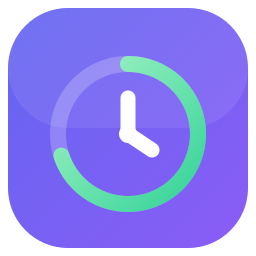
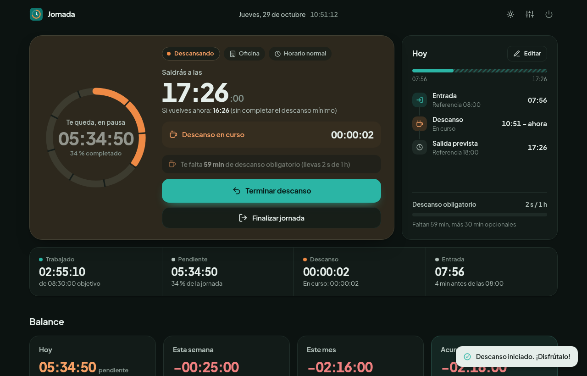
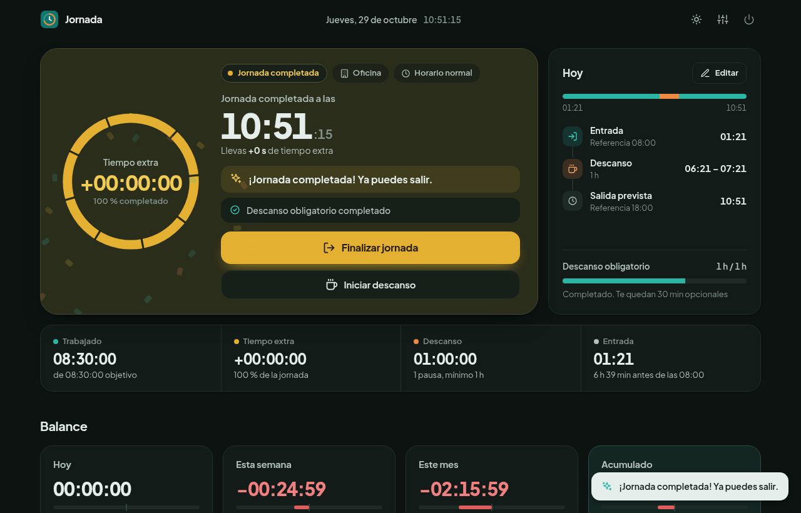
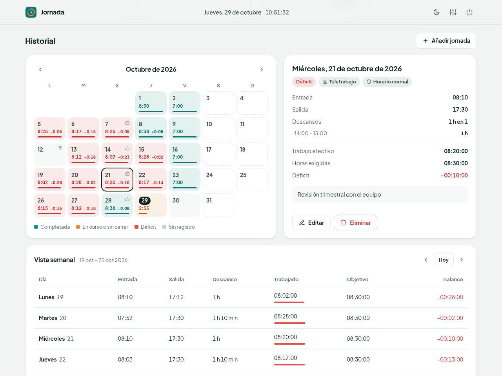
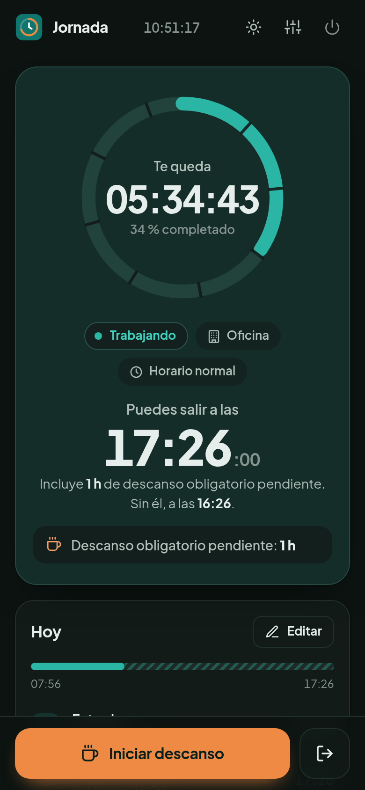

<p align="center">
  
</p>

<h1 align="center">Jornada</h1>

<p align="center">
  <strong>Personal workday tracker with real-time countdowns, flexible schedules, break tracking and local JSON storage.</strong><br>
  Cuánto llevas, cuánto te queda y a qué hora exacta puedes irte a casa.
</p>

<p align="center">
  
</p>

> **Herramienta personal.** Jornada sirve para llevar tu propio control de horas. **No es un sistema
> oficial de registro de jornada** ni tiene validez laboral o legal. Tus datos no salen de tu equipo.

---

## Por qué existe

Cada mañana abres Jornada, pulsas **Iniciar jornada** y ya no tienes que hacer cuentas.
Ves la cuenta atrás de lo que te queda, la hora exacta de salida con tus descansos incluidos,
y el balance de horas de más o de menos, sin minutos de más ni de menos.

Es una aplicación pequeña: Python, Flask, HTML, CSS y JavaScript sin frameworks, con los datos en un archivo JSON.
Funciona **sin internet, sin base de datos, sin Node.js y sin permisos de administrador**.

## Capturas

| Descanso en curso (oscuro) | Jornada completada |
|---|---|
|  |  |

| Historial, detalle y semana | Móvil |
|---|---|
|  |  |

*Las capturas usan datos ficticios.*

## Funciones

**Día a día**
- Cuenta atrás del trabajo efectivo pendiente, actualizada cada segundo y siempre calculada a partir
  de las marcas guardadas. Sigue siendo exacta si cierras el navegador o el equipo se suspende.
- Hora exacta de salida, que incluye el descanso obligatorio que aún te falta. También muestra a qué hora
  saldrías sin él y usando el descanso opcional.
- Varios descansos al día. Durante el descanso, el contador de trabajo se congela y otro cuenta la pausa.
- Al completar las horas, aviso «¡Jornada completada! Ya puedes salir.» y, si sigues, tiempo extra.
- Anillo de progreso con una marca por cada hora del objetivo, como la esfera de un reloj.

**Flexibilidad**
- Puedes trabajar más o menos, saltarte un descanso o finalizar antes: Jornada **avisa, nunca bloquea**.
- Cualquier fichaje se puede editar, también los de días cerrados. Los días olvidados se añaden a mano.
- Las validaciones solo evitan datos imposibles: salidas antes de la entrada, descansos solapados u horas en el futuro.

**Horarios**
- Perfiles editables: *Horario normal* (8 h 30 min y 1 h de descanso + 30 min opcionales),
  *Viernes intensivo* (7 h) e *Intensivo de verano* (7 h).
- Períodos de verano por fechas, más un perfil manual para cualquier día.
  Prioridad: **manual > período > semana habitual**.
- Cada jornada guarda el objetivo que tenía. Cambiar los ajustes no reescribe el pasado.

**Balance**
- Balance de hoy, de la semana, del mes y **acumulado total**, con barra positiva o negativa.
- Lo pendiente de una jornada en curso no se cuenta como déficit, ni tampoco los días futuros, los no laborables o los libres.
- Calendario mensual con horas trabajadas, balance por día y colores de estado, y vista semanal con totales.

**Interfaz**
- Modo claro, oscuro o según el sistema. Diseño adaptado de 375 px a pantallas de escritorio.
  En el móvil, el botón de fichaje queda fijo abajo.
- Animaciones breves que comunican cambios de estado. Respeta `prefers-reduced-motion`.
- Funciona sin conexión: la fuente y los iconos van incluidos y no se usa ninguna CDN.

## Requisitos

- **Python 3.10 o superior**. Es lo único necesario.
  Flask y sus dependencias van incluidas en [`vendor/`](vendor/): **no hace falta `pip`, `venv` ni internet**.
- Un navegador moderno (Firefox, Chrome, Edge o Safari recientes).

## Instalación

```bash
git clone https://github.com/<tu-usuario>/jornada.git
cd jornada
```

O descarga el ZIP del repositorio y descomprímelo en tu carpeta de usuario. No hay nada más que instalar.

## Uso

### Linux: icono en el escritorio y en el menú

```bash
./instalar-escritorio.sh
```

Solo escribe en tu carpeta de usuario y no necesita `sudo`. Crea tres accesos directos:

- `~/.local/share/applications/jornada.desktop`: Jornada en el menú de aplicaciones.
- `~/Escritorio/Jornada.desktop`, o `~/Desktop`: el icono del escritorio.
- `Jornada.desktop` en la carpeta del proyecto.

Haz doble clic en el icono: se abre el navegador en `http://127.0.0.1:8765`.
Si tu escritorio marca el icono como «no confiable», autorízalo una sola vez:

| Escritorio | Qué hacer |
|---|---|
| GNOME / Ubuntu | Clic derecho → **Permitir lanzar**. El script ya intenta marcarlo como de confianza con `gio`. |
| KDE Plasma | En el primer doble clic, **Ejecutar** y «No volver a preguntar». |
| XFCE | **Marcar como ejecutable** o **Iniciar de todas formas**. |
| Cinnamon / MATE | Propiedades → Permisos → **Permitir ejecutar como programa**. |

Si mueves la carpeta, vuelve a ejecutar el script. Para quitar los accesos directos: `./instalar-escritorio.sh --quitar`.
También puedes arrancar directamente con `./iniciar.sh`.

### Windows

Doble clic en **`iniciar.bat`**. Se abre una consola y el navegador.
Si no encuentra Python, el propio lanzador explica opciones que **no requieren administrador**:

- El instalador de python.org «solo para mi usuario».
- El paquete *embeddable* descomprimido en una carpeta `python\` dentro del proyecto.

### Cerrar Jornada

- Botón **⏻ Cerrar Jornada**, arriba a la derecha: detiene el servidor y libera el puerto.
- Cerrar la pestaña **no** detiene el servidor. Al volver a pulsar el icono, retomas la misma sesión.
- Si nadie la usa durante 12 horas, se cierra sola. Puedes cambiarlo con `JORNADA_IDLE_HOURS`; con `0`, nunca.

### Opciones

```bash
python3 app.py --open                    # abre el navegador al arrancar
python3 app.py --port 9000               # puerto preferido (por defecto 8765; también PORT=9000)
WORKTIME_DATA_DIR=/otra/ruta python3 app.py
```

- **Solo local:** escucha únicamente en `127.0.0.1` y rechaza cualquier petición que no llegue como `localhost`.
- **Puerto ocupado:** si otro programa lo usa, prueba con el siguiente sin tocar ese programa.
- **Sin duplicados:** un segundo arranque detecta la instancia abierta gracias a `data/.jornada-run.json`,
  que guarda su PID y su puerto, y solo abre el navegador.

## Cómo calcula

- **Trabajo efectivo** = (salida o ahora) − entrada − descansos.
- **Salida prevista** = ahora + trabajo restante + descanso obligatorio aún no hecho.

Ejemplo: entrada a las 07:53 y pausa de 14:50 a 15:49, con un objetivo de 8 h 30 min.
Al volver te queda 1 h 33 min, así que la salida es a las **17:22**. Como falta 1 minuto de pausa obligatoria,
cumpliéndolo la salida es a las **17:23**.

Las horas se interpretan en `Europe/Madrid` y las duraciones se calculan en UTC,
así que los cambios de horario de verano e invierno no alteran los totales.

## Tus datos

Todo se guarda en `data/`, que se crea sola y **está excluida de Git**:

| Archivo | Contenido |
|---|---|
| `data/records.json` | Jornadas: fichajes, descansos, objetivo y perfil de cada día |
| `data/settings.json` | Perfiles, semana habitual, períodos de verano y apariencia |

Ejemplo con datos **ficticios** de `records.json`:

```json
{
  "version": 1,
  "days": {
    "2026-03-02": {
      "clock_in": "2026-03-02T08:00:00+01:00",
      "clock_out": "2026-03-02T17:35:00+01:00",
      "breaks": [{ "start": "2026-03-02T14:00:00+01:00", "end": "2026-03-02T15:00:00+01:00" }],
      "profile": "normal",
      "profile_source": "weekly",
      "target_minutes": 510,
      "min_break_minutes": 60,
      "optional_break_minutes": 30,
      "mode": "office",
      "notes": ""
    }
  }
}
```

Cada guardado es atómico: se escribe en un archivo temporal, se fuerza a disco con `fsync` y se sustituye con `os.replace`.
Se conserva la versión anterior como `*.json.bak`, y un archivo corrupto se aparta y se recupera desde ella.
Para hacer una copia de seguridad, copia la carpeta `data/`.

## Desarrollo

```bash
python3 -m unittest -v      # 63 pruebas: cálculos, perfiles, API, persistencia y arranque real
```

```text
app.py                 servidor Flask (solo 127.0.0.1), API y ciclo de vida
core.py                cálculos, perfiles, validación y estadísticas (sin Flask)
storage.py             JSON con escritura atómica
templates/index.html   estructura de la interfaz
static/css/style.css   sistema visual (tokens, estados, responsive, animación)
static/js/app.js       lógica de la interfaz (sin frameworks)
static/fonts/          Plus Jakarta Sans (OFL)
static/img/            icono
iniciar.sh / .bat      lanzadores
instalar-escritorio.sh accesos directos de Linux
vendor/                Flask y dependencias (Python puro)
tests/                 pruebas
```

El código de la interfaz no usa librerías: CSS para las transiciones y la Web Animations API
para los momentos puntuales, como el cambio de mes o la celebración.

## Futuras mejoras

- Exportar el historial a CSV o PDF para archivarlo personalmente.
- Notas rápidas por fichaje, por ejemplo «cita médica» en un descanso.
- Atajos de teclado: espacio para pausar o reanudar.
- Importar fichajes desde un CSV.
- Recordatorio opcional si pasan muchas horas sin descanso.
- Interfaz en inglés.

## Licencia

El código de Jornada se publica con licencia [MIT](LICENSE).
Los componentes de terceros conservan las suyas:

- Flask, Werkzeug, Jinja2, MarkupSafe, itsdangerous, Click y Blinker: BSD-3-Clause.
- tzdata: Apache-2.0.
- Plus Jakarta Sans: SIL OFL 1.1.

Los textos están en `vendor/*.dist-info/` y `static/fonts/`.
