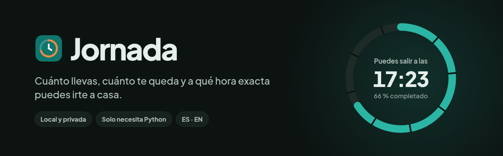

<p align="center">
  
</p>

<p align="center">
  <a href="LICENSE"></a>
  
  
  
  
  
</p>

<p align="center">
  <b>Español</b> · <a href="README.en.md">English</a>
</p>

<p align="center">
  <a href="#instalación-rápida-en-linux">Instalación</a> ·
  <a href="#cómo-utilizar-jornada">Uso</a> ·
  <a href="#atajos-de-teclado">Atajos</a> ·
  <a href="#exportación-e-importación">Exportar e importar</a> ·
  <a href="#persistencia-y-privacidad">Privacidad</a> ·
  <a href="#solución-de-problemas">Problemas</a>
</p>

---

**Jornada** es una pequeña aplicación web que se ejecuta en tu propio ordenador y te dice, de un vistazo,
cuánto llevas trabajado, cuánto te queda y **a qué hora exacta puedes salir**, con tus descansos incluidos.
Funciona sin conexión, guarda todo en un archivo JSON local y no necesita permisos de administrador.

> [!IMPORTANT]
> Jornada es una **herramienta personal**. No es un sistema oficial de registro de jornada y no tiene validez laboral ni legal.
> Sirve para llevar tu propio control.

## Índice

1. [Capturas y demostración](#capturas-y-demostración)
2. [Características principales](#características-principales)
3. [Requisitos](#requisitos)
4. [Instalación rápida en Linux](#instalación-rápida-en-linux)
5. [Instalación rápida en Windows](#instalación-rápida-en-windows)
6. [Crear un acceso directo en el escritorio](#crear-un-acceso-directo-en-el-escritorio)
7. [Cómo utilizar Jornada](#cómo-utilizar-jornada)
8. [Horarios normales e intensivos](#horarios-normales-e-intensivos)
9. [Atajos de teclado](#atajos-de-teclado)
10. [Exportación e importación](#exportación-e-importación)
11. [Idiomas y temas](#idiomas-y-temas)
12. [Persistencia y privacidad](#persistencia-y-privacidad)
13. [Arquitectura del proyecto](#arquitectura-del-proyecto)
14. [Desarrollo y pruebas](#desarrollo-y-pruebas)
15. [Solución de problemas](#solución-de-problemas)
16. [Roadmap](#roadmap)
17. [Contribuciones](#contribuciones)
18. [Licencia](#licencia)

## Capturas y demostración

<p align="center">
  <picture>
    <source media="(prefers-color-scheme: dark)" srcset="docs/screenshots/dashboard-dark.png">
    
  </picture>
</p>

<p align="center">
  <br>
  <sub>Iniciar jornada → descanso → vuelta al trabajo → jornada completada (grabación real, datos ficticios).</sub>
</p>

<table>
  <tr>
    <td width="50%"><br><sub><b>Modo claro</b>: trabajando, con la salida prevista.</sub></td>
    <td width="50%"><br><sub><b>Modo oscuro</b>: en descanso, el panel cambia a tonos cálidos.</sub></td>
  </tr>
  <tr>
    <td><br><sub><b>Historial</b>: calendario, detalle con notas y vista semanal.</sub></td>
    <td><br><sub><b>Atajos</b>: asigna cualquier combinación, como en un videojuego.</sub></td>
  </tr>
  <tr>
    <td><br><sub><b>Ajustes</b>: perfiles, semana habitual y verano.</sub></td>
    <td><br><sub><b>Importar</b>: vista previa antes de guardar nada.</sub></td>
  </tr>
  <tr>
    <td><br><sub><b>Informe PDF</b>: listo para imprimir en A4.</sub></td>
    <td align="center"><br><sub><b>Móvil</b>: el fichaje queda al alcance del pulgar.</sub></td>
  </tr>
</table>

<sub>Todas las capturas son de la aplicación real con datos ficticios.</sub>

## Características principales

| | |
|---|---|
| ⏱️ **Cuenta atrás en vivo** | El tiempo que te queda se actualiza cada segundo. Se calcula a partir de las marcas guardadas, así que sigue siendo exacto aunque cierres el navegador o el equipo se suspenda. |
| 🏁 **Hora exacta de salida** | Incluye el descanso obligatorio pendiente. Muestra también a qué hora saldrías sin él y usando el descanso opcional. |
| ☕ **Descansos múltiples** | Durante la pausa, el trabajo se congela y otro contador mide el descanso. Te avisa si falta descanso mínimo. |
| 🎉 **Jornada completada** | Celebración discreta al llegar al objetivo; si sigues trabajando, cuenta el tiempo extra. |
| ⚖️ **Balance flexible** | Horas de más y de menos por día, semana, mes y acumulado total. Avisa, pero nunca bloquea. |
| 🗓️ **Horarios** | Horario normal, viernes intensivo e intensivo de verano por fechas, con un perfil manual para cualquier día. |
| 📝 **Notas** | Una nota para cada jornada y otra para cada descanso. Nunca cambian los cálculos. |
| ⌨️ **Atajos configurables** | Cualquier combinación para las acciones principales, con detección de conflictos. |
| 📤 **CSV y PDF** | Exporta historial, semana, mes o rango de fechas. Informe A4 imprimible. |
| 📥 **Importación segura** | Vista previa, gestión de duplicados y copia de seguridad antes de guardar. |
| 🌍 **Español e inglés** | Cambia al instante, sin recargar. |
| 🌗 **Claro y oscuro** | Tema claro, oscuro o según el sistema; diseño adaptado a escritorio, tableta y móvil. |

## Requisitos

- **Python 3.10 o superior.** Es lo único que necesitas tener. Flask y sus dependencias ya vienen
  incluidas en la carpeta [`vendor/`](vendor/).
- Un navegador moderno: Firefox, Chrome, Edge o Safari.

**No** necesitas `pip`, `npm`, Node.js, Docker, una base de datos, conexión a internet ni permisos de administrador.

> [!NOTE]
> Jornada no es un ejecutable autónomo: sin Python no puede funcionar. Si tu equipo no lo tiene,
> mira [cómo conseguirlo sin administrador](#no-se-encuentra-python).

## Instalación rápida en Linux

**Opción A: con Git**

```bash
git clone https://github.com/<tu-usuario>/jornada.git
cd jornada
./iniciar.sh
```

**Opción B: descargando el ZIP**

1. En GitHub, pulsa **Code → Download ZIP**.
2. Descomprímelo dentro de tu carpeta de usuario, por ejemplo en `~/jornada`.
3. Abre una terminal en esa carpeta y ejecuta `./iniciar.sh`.

El navegador se abre en `http://127.0.0.1:8765`. Para tener un icono en el escritorio, sigue el apartado
[Crear un acceso directo](#crear-un-acceso-directo-en-el-escritorio).

## Instalación rápida en Windows

1. Descarga el proyecto, con `git clone` o como ZIP, y descomprímelo en tu carpeta de usuario.
2. Haz doble clic en **`iniciar.bat`**.
3. Se abre una consola, que es el servidor, y el navegador con Jornada.

Si el lanzador no encuentra Python, te explica alternativas que **no requieren administrador**.
Mira también [No se encuentra Python](#no-se-encuentra-python).

## Crear un acceso directo en el escritorio

En **Linux**, una sola vez y sin `sudo`:

```bash
./instalar-escritorio.sh
```

Esto crea:

- `~/.local/share/applications/jornada.desktop`: Jornada aparece en el menú de aplicaciones.
- `~/Escritorio/Jornada.desktop` (o `~/Desktop`): el icono del escritorio.
- `Jornada.desktop` dentro del proyecto, para arrancar desde el gestor de archivos.

Si tu escritorio marca el icono como «no confiable», autorízalo una vez:

| Escritorio | Qué hacer |
|---|---|
| GNOME / Ubuntu | Clic derecho en el icono → **Permitir lanzar**. |
| KDE Plasma | En el primer doble clic, **Ejecutar** y «No volver a preguntar». |
| XFCE | **Marcar como ejecutable** o **Iniciar de todas formas**. |
| Cinnamon / MATE | Propiedades → Permisos → **Permitir ejecutar como programa**. |

Si mueves la carpeta del proyecto, vuelve a ejecutar el script. Para quitar los accesos directos,
usa `./instalar-escritorio.sh --quitar`; tus datos no se tocan.

En **Windows**, crea un acceso directo a `iniciar.bat` (clic derecho → *Enviar a → Escritorio*).

## Cómo utilizar Jornada

### Abrir y cerrar

- **Abrir:** doble clic en el icono, en `iniciar.sh` o en `iniciar.bat`. Si Jornada ya estaba abierta,
  solo se abre el navegador; nunca se crea una segunda instancia.
- **Cerrar por completo:** botón **⏻**, arriba a la derecha → *Cerrar Jornada*. Detiene el servidor
  y libera el puerto. Cerrar solo la pestaña no detiene el servidor.
- **Cierre automático:** si nadie la usa durante 12 horas, se cierra sola. Puedes cambiarlo con
  `JORNADA_IDLE_HOURS`; con `0` no se cierra nunca.

### Un día de ejemplo

Con el horario normal: 8 h 30 min de trabajo efectivo y 1 h de descanso obligatorio.

| Momento | Qué haces | Qué muestra Jornada |
|---|---|---|
| **07:53** | Pulsas **Iniciar jornada** | Salida prevista **17:23** (07:53 + 8 h 30 min + 1 h de descanso). |
| **12:00** | Consultas el panel | Trabajado **4 h 07 min**; te quedan **4 h 23 min**; salida, **17:23**. |
| **14:50** | **Iniciar descanso** | El contador de trabajo se congela; otro mide la pausa. |
| **15:49** | **Terminar descanso** (59 min) | Antes de la pausa: 6 h 57 min. Te quedan **1 h 33 min**: puedes salir a las **17:22**. Falta **1 min** de descanso obligatorio; si lo completas, la salida es a las **17:23**. |
| **17:22** | — | **¡Jornada completada! Ya puedes salir.** A partir de aquí cuenta como tiempo extra. |
| **17:45** | **Finalizar jornada** | Trabajado **8 h 53 min**: balance del día **+23 min**. |

El balance se acumula sin obligarte a compensarlo. Con +25, −15, +40 y −10 minutos en cuatro días,
el balance de la semana es **+40 min**. Puedes revisarlo en el apartado **Balance** (hoy, semana, mes y acumulado)
y en el calendario, donde cada día muestra sus horas y su exceso o déficit.

### Corregir fichajes

- **Editar** abre el editor del día: entrada, salida, descansos, perfil, objetivo y notas.
  La salida y los descansos se validan: no puede haber salida antes de la entrada, descansos solapados ni horas futuras.
- **Añadir jornada** registra un día que olvidaste fichar.
- **Reanudar jornada** deshace un «Finalizar» por error: el hueco se cuenta como descanso.

### Notas

- **Nota del día:** icono 📝 en la tarjeta «Hoy» o «Añadir nota» en el detalle de cualquier día.
- **Nota de un descanso:** icono 📝 junto a cada descanso, en la línea de tiempo o en el detalle.
- Hay sugerencias rápidas, como «Reunión con el equipo» o «Cita médica». Las notas se ven discretamente en el calendario y se incluyen al exportar.
  **Nunca modifican los cálculos de tiempo.**

## Horarios normales e intensivos

| Perfil | Por defecto (editable en *Ajustes → Horario*) |
|---|---|
| Horario normal | 08:00–18:00 · 8 h 30 min efectivas · descanso de 60 min + 30 opcionales |
| Viernes intensivo | 08:00–15:00 · 7 h efectivas |
| Intensivo de verano | 08:00–15:00 · 7 h efectivas · aplicable por fechas, por ejemplo del 1/7 al 31/8 |

- Cada día de la semana tiene su perfil, si es laborable y su modalidad (oficina o teletrabajo).
- **Prioridad:** perfil elegido a mano para un día > período de verano > semana habitual.
- Cada jornada **conserva el perfil y el objetivo** que tenía, así que cambiar los ajustes no reescribe el pasado.
- 7 h trabajadas en un día de 7 h dan balance 0, nunca déficit.

## Atajos de teclado

*Ajustes → Atajos.* Pulsa **Asignar tecla** y después la combinación que quieras.

| Acción | Predeterminado |
|---|---|
| Iniciar jornada | <kbd>Alt</kbd> + <kbd>Mayús</kbd> + <kbd>I</kbd> |
| Iniciar descanso | <kbd>Alt</kbd> + <kbd>Mayús</kbd> + <kbd>D</kbd> |
| Finalizar descanso | <kbd>Alt</kbd> + <kbd>Mayús</kbd> + <kbd>V</kbd> |
| Finalizar jornada | <kbd>Alt</kbd> + <kbd>Mayús</kbd> + <kbd>F</kbd> |
| Abrir calendario | <kbd>Alt</kbd> + <kbd>Mayús</kbd> + <kbd>C</kbd> |
| Abrir estadísticas | <kbd>Alt</kbd> + <kbd>Mayús</kbd> + <kbd>B</kbd> |
| Abrir ajustes | <kbd>Alt</kbd> + <kbd>Mayús</kbd> + <kbd>A</kbd> |
| Cambiar tema claro/oscuro | <kbd>Alt</kbd> + <kbd>Mayús</kbd> + <kbd>T</kbd> |
| Editar el día actual | <kbd>Alt</kbd> + <kbd>Mayús</kbd> + <kbd>E</kbd> |

- **Duplicados:** Jornada los detecta y no los asigna.
- **Atajos reservados:** avisa de los que suelen pertenecer al navegador o al sistema (por ejemplo, <kbd>Ctrl</kbd>+<kbd>T</kbd>).
- **Gestión:** puedes quitar una asignación o restaurar los valores predeterminados.
- **Cuándo actúan:** solo con la pestaña de Jornada activa, nunca mientras escribes en un campo ni con una ventana abierta.
- **Qué ejecutan:** solo acciones válidas en ese momento; por ejemplo, «Finalizar descanso» no hace nada si no estás descansando.
- **Teclas físicas:** se identifican por su posición (`KeyboardEvent.code`), así que funcionan igual en cualquier distribución de teclado.
- **Sin atajos globales:** no se instala ningún atajo del sistema.

## Exportación e importación

Desde **Historial → Exportar o importar**, o desde *Ajustes → Datos*.

### Exportar

- **Qué:** todo el historial, la semana actual, el mes seleccionado o un rango de fechas.
- **CSV:** compatible con Excel y LibreOffice (UTF-8, separado por punto y coma). Una columna por dato: fecha,
  modalidad, perfil, entrada, salida, trabajo efectivo, objetivo, balance, notas y cada descanso con su nota.
- **Informe PDF:** se abre una página lista para imprimir o *Guardar como PDF* en A4, con tabla de jornadas
  y resumen del período (trabajado, objetivo, descansos, tiempo de más y de menos).

### Importar

1. Elige o arrastra un CSV. Puede ser uno exportado por Jornada, también si lo has vuelto a guardar con Excel.
2. Jornada valida **todo** el archivo (fechas, horas, descansos y estructura) y muestra una vista previa: nuevas, ya existentes y con errores.
3. Para las fechas que ya existen, elige **omitirlas** o **sobrescribir solo las que marques**. Sobrescribir pide confirmación.
4. Al confirmar se guarda **una copia de seguridad** en `data/backups/` y los cambios se escriben de una sola vez.

Si algo cambia entre la vista previa y la confirmación, la importación se detiene sin escribir nada.
Exportar y volver a importar conserva todos los datos relevantes; hay pruebas automáticas que lo comprueban.

## Idiomas y temas

- **Idioma:** español (predeterminado) o inglés, desde el botón 🌐 de la barra superior o en *Ajustes → Apariencia*.
  El cambio es inmediato, sin recargar, y se guarda.
- **Tema:** claro, oscuro o según el sistema (botón ☀️/🌙 o *Ajustes → Apariencia*).
- **Formatos:** hora en 24 h o 12 h, y duraciones como `02:34:18` o `2 h 34 min`.

Los textos viven en [`static/i18n/`](static/i18n/). Para añadir un idioma, copia `es.json` con otro nombre,
tradúcelo y añade su código a `LANGUAGES` en [`i18n.py`](i18n.py).

## Persistencia y privacidad

- 🏠 **Todo se guarda en tu equipo**, en la carpeta `data/`. No hay cuentas, ni base de datos externa, ni sincronización en la nube.
- 🔒 **Solo localhost:** el servidor escucha únicamente en `127.0.0.1` y rechaza las peticiones con otro nombre de host.
- 📴 **Sin conexión:** no se usa ninguna CDN; la fuente y los iconos van incluidos.
- 💾 **Guardado seguro:** cada cambio se escribe al instante y de forma atómica (archivo temporal, `fsync` y `os.replace`).
  La versión anterior queda como `*.json.bak`.

| Archivo | Contenido |
|---|---|
| `data/records.json` | Tus jornadas: fichajes, descansos, notas, perfil y objetivo de cada día |
| `data/settings.json` | Perfiles, semana, verano, atajos, idioma y apariencia |
| `data/backups/` | Copias creadas antes de cada importación |

> [!WARNING]
> **No subas `data/` a ningún repositorio.** El `.gitignore` del proyecto ya la excluye, junto con el acceso directo generado,
> que contiene rutas de tu equipo.

## Arquitectura del proyecto

```text
jornada/
├── app.py                 Servidor Flask (solo 127.0.0.1), API, ciclo de vida y puerto
├── core.py                Cálculos, perfiles, validación, notas y estadísticas (sin Flask)
├── csvio.py               Exportación e importación CSV
├── i18n.py                Traducciones del servidor (usa los mismos JSON que el navegador)
├── storage.py             JSON con escritura atómica y recuperación
├── templates/
│   ├── index.html         Interfaz (llega ya traducida desde el servidor)
│   └── report.html        Informe imprimible A4
├── static/
│   ├── css/style.css      Sistema visual: tokens, estados, responsive y movimiento
│   ├── js/                app.js · i18n.js · shortcuts.js · datatools.js (sin frameworks)
│   ├── i18n/              es.json · en.json
│   ├── fonts/             Plus Jakarta Sans (OFL)
│   └── img/               Icono
├── vendor/                Flask y dependencias (Python puro, con sus licencias)
├── tests/                 Pruebas automáticas
├── iniciar.sh · iniciar.bat · instalar-escritorio.sh
└── docs/                  Banner, capturas y demostración
```

Principios: las duraciones se calculan en UTC a partir de marcas guardadas, nunca con un contador en memoria.
Las horas se interpretan en `Europe/Madrid`, con los cambios de horario incluidos. La interfaz es HTML, CSS y JavaScript sin dependencias.

## Desarrollo y pruebas

```bash
python3 -m unittest -v        # 87 pruebas
python3 app.py --open         # arranque manual
python3 app.py --port 9000    # otro puerto preferido (también PORT=9000)
WORKTIME_DATA_DIR=/tmp/pruebas python3 app.py   # datos de prueba en otra carpeta
```

Las pruebas cubren:

- **Cálculos:** el ejemplo de 07:53, el cambio de horario, perfiles y prioridades.
- **Validaciones, notas y preferencias.**
- **Exportación e importación:** ida y vuelta, duplicados, archivos vueltos a guardar con Excel y protección frente a fórmulas.
- **Traducciones:** las mismas claves en ambos idiomas y ninguna clave usada sin traducir.
- **Arranque real:** segunda instancia, puerto ocupado y cierre limpio.

## Solución de problemas

<details>
<summary><b>No se encuentra Python</b></summary>

- **Linux:** casi todas las distribuciones incluyen `python3`. Sin permisos de administrador puedes descomprimir un Python
  portable en `./python/`, de modo que quede `python/bin/python3`.
- **Windows:** usa el instalador de python.org con *Customize installation*, sin marcar *Install for all users*
  (se instala solo para tu usuario). Otra opción es descomprimir el *Windows embeddable package* en una carpeta `python\` dentro del proyecto.
- Si tu empresa bloquea todas estas vías, la única alternativa es pedir Python al departamento de informática.
</details>

<details>
<summary><b>El puerto 8765 está ocupado</b></summary>

Jornada prueba automáticamente 8766, 8767… hasta 8784, sin tocar el programa que ocupa el puerto.
También puedes elegir otro con `--port`.
</details>

<details>
<summary><b>El doble clic no abre nada en Linux</b></summary>

Autoriza el icono (tabla de [acceso directo](#crear-un-acceso-directo-en-el-escritorio)) y vuelve a ejecutar `./instalar-escritorio.sh`
si moviste la carpeta. Si arrancas sin terminal, los mensajes quedan en `data/jornada.log`.
</details>

<details>
<summary><b>Tras actualizar, la página falla o se ve antigua</b></summary>

Puede seguir abierto el servidor de la versión anterior. Ciérralo con **⏻** y vuelve a abrir Jornada.
</details>

<details>
<summary><b>Un atajo no hace nada</b></summary>

Comprueba que la pestaña de Jornada tiene el foco, que no estás escribiendo en un campo y que no hay ninguna ventana abierta.
Si Jornada te avisa de que la combinación está reservada, el navegador puede quedársela: elige otra.
</details>

<details>
<summary><b>Excel muestra caracteres extraños al abrir el CSV</b></summary>

El CSV está en UTF-8 con BOM, que Excel reconoce. Si lo abres con *Datos → Desde texto*, elige UTF-8 y el separador «;».
Jornada también importa archivos que Excel haya vuelto a guardar con coma o en Windows-1252.
</details>

## Roadmap

Ideas que podrían llegar; no están implementadas:

- Más idiomas (catalán, gallego, euskera, portugués…), sin cambiar el código.
- Recordatorio opcional si llevas muchas horas sin descansar.
- Objetivos semanales además de diarios.
- Gráfica sencilla de la evolución del balance.
- Paquete ejecutable autónomo para equipos sin Python.

## Contribuciones

Las contribuciones son bienvenidas. Mantén el espíritu del proyecto: **pequeño, local y sin dependencias que instalar**.

1. Abre un *issue* describiendo el cambio.
2. Ejecuta `python3 -m unittest` antes de enviar un *pull request* y añade pruebas para lo nuevo.
3. Todo texto visible va en `static/i18n/es.json` y `en.json`, con las mismas claves.
4. Nunca incluyas datos reales en ejemplos, capturas ni pruebas.

## Licencia

El código de Jornada se publica con licencia [MIT](LICENSE). Los componentes de terceros conservan las suyas:

- Flask, Werkzeug, Jinja2, MarkupSafe, itsdangerous, Click y Blinker: BSD-3-Clause.
- tzdata: Apache-2.0.
- Plus Jakarta Sans: SIL OFL 1.1.

Los textos están en `vendor/*.dist-info/` y `static/fonts/`.
